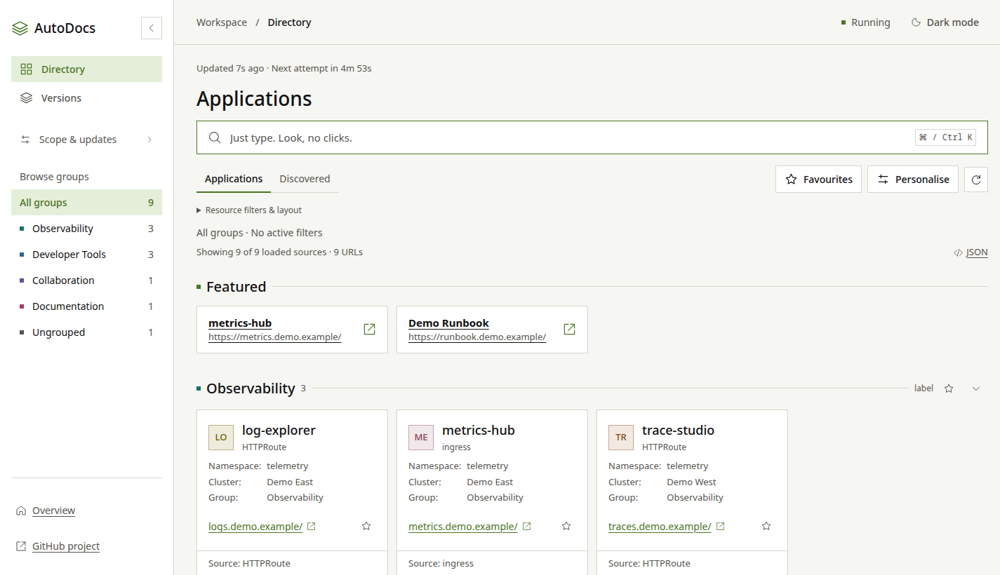
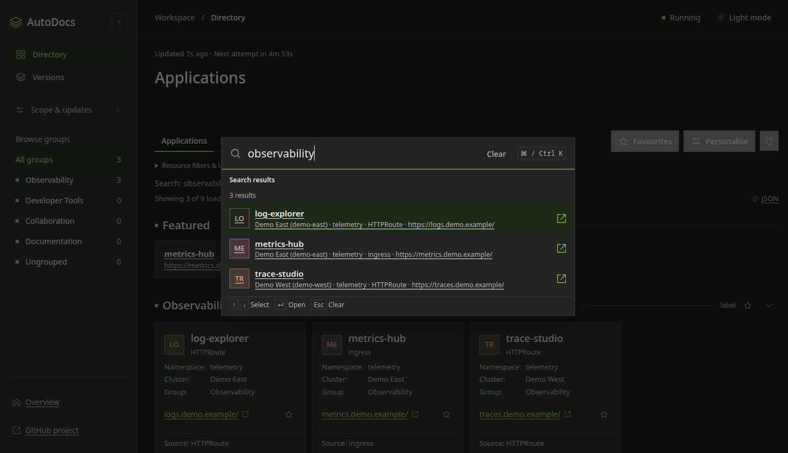

# goK8sAutoDocs

Experimental, read-only Kubernetes inventory and application directory.

- Find published Ingress, HTTPRoute, ExternalDNS Service and manual links.
- Feature shared links, order source-label groups and personalise your directory.
- Search the active view and open results from the keyboard with spotlight search.
- Compare Deployment, StatefulSet and DaemonSet container versions.
- Collect shared inventory in the background, with per-component freshness and optional persistent snapshots.
- Connect explicit targets or discover clusters through Rancher.

## Deploy

| Channel | Container image |
| --- | --- |
| Current stable release | `ghcr.io/tintii/k8sautodocs:v0.6.0` |
| Release candidate with Featured links, shared group ordering and spotlight search | `ghcr.io/tintii/k8sautodocs:v0.7.0-RC1` |

Pull the release candidate to try the new directory features.

```bash
docker pull ghcr.io/tintii/k8sautodocs:v0.7.0-RC1
```

The image is built for `linux/amd64` and serves on port `8080`. Follow the
[container setup](docs/installation.md#container) to provide a read-only Kubernetes
context, or the [Kubernetes setup](docs/installation.md#kubernetes) for ServiceAccount
permissions and deployment settings. Pin the image digest for repeatable deployments.
See the [container packages](https://github.com/tintii/goK8sAutoDocs/pkgs/container/k8sautodocs)
and [release history](CHANGELOG.md) for version details.

To configure shared Featured links and group ordering, mount the directory
settings file and set `AUTODOCS_DIRECTORY_CONFIG`. [Example YAML](config/directory.example.yaml)
· [Configuration guide](docs/configuration.md#shared-applications-settings)

## Screenshots

Both screenshots use simulated clusters, namespaces, applications and URLs.





## Run from source

You need Git, Go **1.24.0+** (module toolchain **1.24.5**, downloaded by Go when
needed), a free port **8080** and read-only Kubernetes credentials in
**`~/.kube/config`** with a current context. AutoDocs does not select credentials
through `KUBECONFIG`. The context must use verified HTTPS and an embedded bearer
token or embedded client certificate/key, with embedded CA data when needed.
Exec helpers, external credential files and insecure TLS are unsupported; see
[credential setup](docs/cluster-discovery.md#remote-cluster-secret-contract).

```bash
git clone https://github.com/tintii/goK8sAutoDocs.git
cd goK8sAutoDocs/go
go mod download
go build -o goK8sAutoDocs .
./goK8sAutoDocs
```

Run from `go/` so the server can find `static/`. Open **http://localhost:8080/**.
Startup collection runs in the background. **Running** means the application
responds; open **Scope & updates → Collection details** to verify collection.
**Applications** may be empty until endpoints are published; **Discovered**
shows eligible unlabelled sources. **Versions** shows collected workloads and
containers. Stop with Ctrl+C.

## Documentation

- [Published user manual](https://tintii.github.io/goK8sAutoDocs/) and [source Markdown](docs/index.md)
- [Getting started and first inventory](docs/getting-started.md)
- [Installation: source, container and Kubernetes](docs/installation.md)
- [Using the dashboards](docs/using-autodocs.md)
- [Configuration](docs/configuration.md) and [connecting clusters](docs/cluster-discovery.md)
- [Publishing endpoints](docs/publishing-endpoints.md) and [manual links](docs/manual-directory-links.md)
- [Operations](docs/operations.md), [troubleshooting](docs/troubleshooting.md) and [API reference](docs/api.md)

## Contributing

Fork the repository, create a feature branch, make a focused change with relevant
tests and submit a pull request. The [OpenSpec specifications](openspec/specs/)
and [implementation archive](openspec/changes/archive/) hold behavior contracts
and design history. The [manual-link specification](openspec/specs/manual-directory-links/spec.md)
records declaration, scope and identity requirements. [Development and documentation maintenance](openspec/changes/archive/2026-11-18-publish-user-manual-on-github-pages/implementation.md)
records build, test and publishing instructions.
